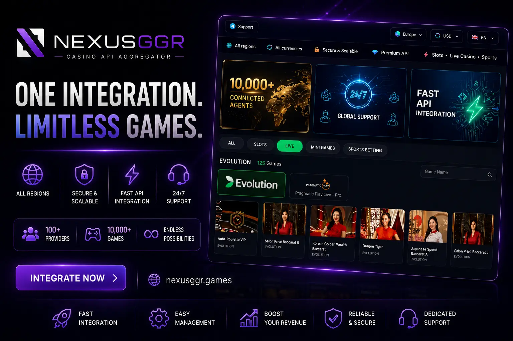

# NexusGGR FiversCan Casino API Aggregator

NexusGGR is an **iGaming API aggregator** for operators and platform owners building online casino and sports betting experiences. Connect slots, live casino, sportsbook, lottery, and mini games through a unified platform, with whitelabel options for launching under your own brand.

Explore the platform: [NexusGGR live demo](https://nexusggr.games?utm_source=github&utm_medium=readme&utm_campaign=casino-api)

  

## Casino and sportsbook API platform

NexusGGR brings multiple iGaming product categories together for operators who want a single integration path instead of managing separate platform connections for every game category. It is designed for FiversCan-compatible workflows and supports casino and sports betting use cases.

The platform is relevant to teams searching for a **casino API**, **casino API aggregator**, **slots API**, **live casino API**, **sportsbook API**, or **whitelabel betting platform**. For Brazil and LATAM audiences, it also serves the cassino API use case; for Turkish-language betting searches, bahis is another relevant term.

## Features

- **Slots API** — Access slot games from Pragmatic Play, PG Soft, and additional studios.
- **Live casino API** — Live table-game categories including baccarat, roulette, blackjack, and game shows.
- **Sportsbook API** — Pre-match and live betting markets.
- **Lottery and mini games** — Lottery, Aviator, Mines, Plinko, Dice, Hi-Lo, Keno, and more.
- **Whitelabel platform** — Launch a casino or betting experience under your own brand.
- **Operator and agent tools** — Panels for managing players, agents, reports, and settlements.
- **Unified integration** — Bring supported product categories together through one platform integration.

## Game categories

| Category | Examples |
| --- | --- |
| Slots | Pragmatic Play, PG Soft, and other slot studios |
| Live casino | Baccarat, roulette, blackjack, and game shows |
| Sportsbook | Pre-match and live sports betting |
| Lottery | Lottery draw games |
| Aviator and mini games | Aviator, Mines, Plinko, Dice, Hi-Lo, and Keno |

## Who is NexusGGR for?

- iGaming operators launching or expanding an online casino or sportsbook
- Agents and master agents managing betting networks
- Platform developers evaluating a casino API aggregator
- Whitelabel partners looking for casino and betting platform options

## Explore NexusGGR

Visit the [NexusGGR live demo](https://nexusggr.games?utm_source=github&utm_medium=readme&utm_campaign=casino-api) to learn more about the platform and its supported products.

## Frequently asked questions

### What is a casino API aggregator?

A casino API aggregator provides a connection between an iGaming platform and multiple game categories or providers, helping operators manage integrations through a unified platform.

### What products does NexusGGR support?

NexusGGR covers slots, live casino, sportsbook, lottery, and mini games. Availability and supported content may depend on the platform setup.

### Does NexusGGR offer a whitelabel casino platform?

NexusGGR offers whitelabel options for operators who want to launch a casino or betting experience under their own brand. Visit the [live demo](https://nexusggr.games?utm_source=github&utm_medium=readme&utm_campaign=casino-api) for platform details.

### Where can I see the platform?

Open the [NexusGGR live demo](https://nexusggr.games?utm_source=github&utm_medium=readme&utm_campaign=casino-api).

---

**NexusGGR** — iGaming API aggregator for casino games, live casino, sportsbook, lottery, and whitelabel platform solutions.
