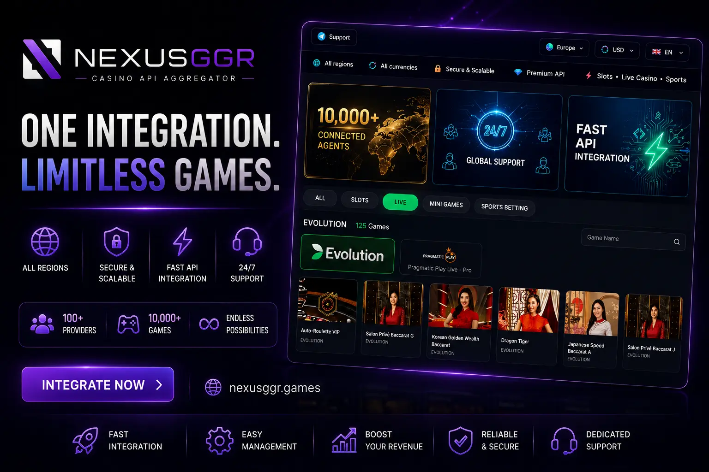

# NexusGGR FiversCan casino API aggregator — slots, live casino, sportsbook, lottery, Aviator & mini games, whitelabel

  

**NexusGGR** is a unified **casino API aggregator** for iGaming operators, agents, and platform owners. Integrate **slots API**, **live casino API**, **sportsbook API**, **lottery API**, **Aviator & mini games**, and **whitelabel betting** solutions through a single integration — powered by leading providers including **Pragmatic Play**, **PG Soft**, and more.

🌐 **[Live Demo](https://nexusggr.games?utm_source=github&utm_medium=readme&utm_campaign=casino-api)**

---

## About NexusGGR Casino API

NexusGGR provides a full-stack **iGaming API** solution for launching and scaling online casino and sports betting platforms. Whether you need a **casino API**, **cassino API** (Brazil/LATAM markets), **bahis sports API**, or a complete **whitelabel betting** backend — NexusGGR delivers one API layer to connect hundreds of games and sports markets.

Built for **FiversCan**-compatible workflows and modern aggregator architectures, NexusGGR helps operators go live faster with less integration overhead.

## Key Features

- **Slots API** — Pragmatic Play, PG Soft and 50+ studios
- **Live Casino API** — Baccarat, roulette, blackjack, game shows
- **Sportsbook API** — Pre-match and live betting
- **Lottery API** — Lottery draw games
- **Aviator & Mini Games** — Aviator, Mines, Plinko, Dice, Hi-Lo, Keno and more
- **Whitelabel** — Launch under your own brand, multi-currency and multi-language
- **Single Integration** — One API endpoint for every category above
- **Agent & Operator Panels** — Manage players, agents, reports, and settlements
- **Fast Deployment** — Launch your iGaming platform in days, not months

## Supported Game Providers

| Category | Providers |
|----------|-----------|
| **Slots** | Pragmatic Play, PG Soft, and 50+ slot studios |
| **Live Casino** | Evolution-style live tables: baccarat, roulette, blackjack, sic bo, game shows |
| **Sportsbook** | Pre-match and live betting: football, basketball, tennis, cricket, esports, virtual sports |
| **Lottery** | Lottery draw games |
| **Aviator & Mini Games** | Aviator, Mines, Plinko, Dice, Hi-Lo, Keno and more |

## Who Is This For?

- **iGaming operators** launching a new online casino or sportsbook
- **Agents & master agents** building a multi-tier betting network
- **Platform developers** needing a reliable **casino API aggregator**
- **LATAM & Asia markets** — cassino API, bahis, and regional payment support
- **Whitelabel partners** seeking turnkey betting infrastructure

## Why Choose NexusGGR?

| Benefit | Description |
|---------|-------------|
| **One API, All Products** | Slots, live casino, sportsbook, lottery, and mini games under one contract |
| **Proven Infrastructure** | Stable API uptime for high-traffic iGaming platforms |
| **Scalable Architecture** | From startup operators to enterprise-level volume |
| **Dedicated Support** | Support for integration and operations |
| **Competitive GGR** | Flexible commercial terms for agents and operators |

## Quick Links

| Resource | Link |
|----------|------|
| 🎰 **Live Demo & Platform** | [nexusggr.games](https://nexusggr.games?utm_source=github&utm_medium=readme&utm_campaign=casino-api) |

## Frequently Asked Questions

### What is a casino API aggregator?

A **casino API aggregator** connects your platform to multiple game providers through a single integration. Instead of signing separate contracts with Pragmatic Play, PG Soft, and others, you integrate once with NexusGGR and access the full game catalog.

### Does NexusGGR support live casino and sports betting?

Yes. NexusGGR covers **slots API**, **live casino API**, and **sportsbook API** — including pre-match and in-play betting markets — plus **lottery API** and **Aviator & mini games** (Mines, Plinko, Dice, Hi-Lo, Keno and more).

### Is NexusGGR a whitelabel betting solution?

Yes. NexusGGR offers **whitelabel betting** and casino infrastructure so you can launch under your own brand with custom domains, themes, and player management.

### Which markets does NexusGGR support?

NexusGGR serves global iGaming markets including Asia, Europe, and LATAM — with support for regional terms like **cassino API** (Brazil/Portugal) and **bahis** (Turkey/MENA sports betting).

### How do I get started?

Visit the [live demo](https://nexusggr.games?utm_source=github&utm_medium=readme&utm_campaign=casino-api) to explore the platform.

---

  <strong>NexusGGR</strong> — Casino API · Slots API · Live Casino API · Sportsbook API · Lottery API · Aviator & Mini Games · iGaming Whitelabel 
  Last updated: 2026-10-28 14:06 UTC

<!-- last-updated: 2026-10-28 14:06 UTC -->
